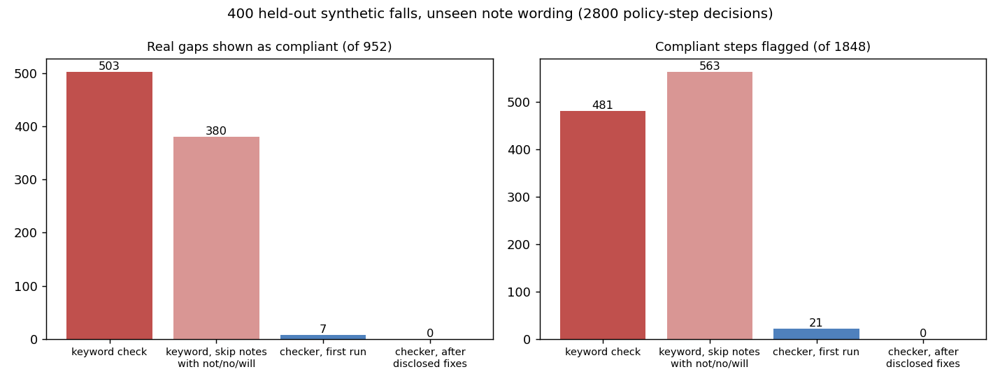

# Post-fall follow-up check from progress notes

> Unofficial prototype by Kushagra Pratap Singh. Not affiliated with Ascenix.

## The problem
[Ascenix](https://www.ascenix.co/product) checks "every incident … against your own post-incident standard, not a generic one". The common gaps it names are missing follow-up notes, missing POA notification and incomplete assessments. It reads the Risk Management records and Progress Notes ([FAQ](https://www.ascenix.co/faq)).

Doing that from free text is harder than finding keywords:
- **Attempts:** "Called daughter (POA), no answer, left VM" contains "POA" and "called", but nobody was notified.
- **Plans and history:** "Will notify Dr in AM", "PFA to be completed by day nurse" and "POA was notified of previous fall" all match the keyword without the step being done.
- **Timed head-injury routines:** after an unwitnessed fall, neuro checks are due at fixed times (e.g. q15 min, then q30, q1h, q4h to 24 h; [survey example](https://info.ncdhhs.gov/DHSR/facilities/nh/2020/20200618-922972.pdf)). Nurses often chart several checks in one later note ("NV @0255, 0310, 0325"), so the note's entry time is the wrong clock. "Next NV due @0740" is a plan, not a check. A documented refusal counts; "HIR stopped, resident sleeping" without an order does not.
- **The form can disagree with the notes:** the incident form says "witnessed", while the nurse's note says the resident "was found on floor". The head-injury routine is still needed.

## What I built
`falltrack/` (stdlib only):
- **`policy.py`:** the home's post-fall policy as data: deadlines for the post-fall assessment, physician/NP and POA/SDM notification, and the care plan review; a follow-up note every shift for 72 h; the head-injury-routine slot schedule with tolerances; escalation after an abnormal neuro finding. Every result cites the policy line.
- **`engine.py`:**
  - reads each note into dated events: who was notified (with the attempt / negation / plan / prior-fall cases above), assessments, care-plan updates, neuro checks (times written in the note, lists, late entries, refusals, abnormal findings), stop orders, follow-up notes;
  - then scores each step as `MET`, `LATE`, `MISSING`, `ATTEMPT_ONLY`, `MISSING_SLOTS` (which neuro checks, by due time), `MISSING_SHIFTS`, `ESCALATION_MISSING` or `NOT_REQUIRED` (e.g. the resident is their own SDM);
  - every decision quotes the note it used, and every clause it ignored is listed with the reason.
- **`baseline.py`:** a keyword audit for comparison (any note in the window containing the keyword counts; neuro checks by note entry time), plus a variant that skips notes with "not/no/will". This is my reconstruction of a simple audit, **not Ascenix's product**.

```
$ python demo.py          (unwitnessed fall at 02:40, synthetic resident)
  POA       ATTEMPT_ONLY    keyword: MET                      1 attempt(s), no contact: "left vm." (N02)
  HIR       MISSING_SLOTS   keyword: MISSING_SLOTS (6 slots)  missing 2/15: 07:40, 12:40 · refused (documented) 08:40
  FOLLOWUP  MISSING_SHIFTS  keyword: MET                      no note in shift Thu 07:00
Ignored by the checker (with reason):
  N07: "next nv due @0740." -> a plan / next due time, not a check
```

## Results: held-out
**Setup:**
- **400 synthetic falls** with planted gaps (missing, late, attempt-only, plan-only, negated, prior-fall-only, dropped neuro checks around shift change, "next due" look-alikes, stops without an order, abnormal findings without a call, form-vs-note mismatch) and look-alikes that are compliant (plan then done, refusals, Self-POA, stop by order, "denies hitting head", family calls about other things).
- **Unseen wording:** the held-out notes come from a separate wording bank, including different time formats, written before the run and never used while building.
- **Frozen in git:** seeds and wording were committed before the first run ([`heldout/`](heldout/), commit `0c98bd4`).



| 2,800 policy-step decisions | Keyword check | Keyword, skip not/no/will | Checker, first run | Checker, after disclosed fixes |
|---|---|---|---|---|
| Real gaps shown compliant (of 952) | 503 | 380 | **7** | 0 |
| Compliant steps flagged (of 1,848) | 481 | 563 | **21** | 0 |
| Missed neuro checks named (of 499) | 251 | 251 | **498** | 499 |
| Neuro checks wrongly called missing | 1,677 | 1,677 | **68** | 0 |

**First run, reported as it came out.** Three bugs caused all of the checker's errors:
- **Time lists with slashes** ("NVS @ 10:32 / 1046 / 1101") were read as one check. This caused the 21 false flags and 68 slots wrongly called missing.
- **A sentence about a prior fall** ("Resident had a prior fall in the spring, family aware of fall risk") counted as POA notification. This caused 6 gaps shown compliant.
- **"4:12 pm" was also read as "12 pm"**, which filled one missed check. This caused 1 gap shown compliant.

I fixed all three with general rules (slash lists; history applies to the whole sentence; overlapping time matches). Dev and held-out are both clean after that. The fixes came after seeing the held-out set, so the after-fix zeros are not a clean held-out number.

**Where keywords fail:** attempts and plans counted as notifications; prior-fall notes counted as shift follow-ups; "Plan of care"/"Kardex" wording not found; checks charted later in one note matched to the wrong times. Skipping notes with negation words trades missed gaps for more false flags ("no new orders", "denies pain").

## Run it
```bash
python demo.py               # one unwitnessed fall: each policy step, the note it rests on, what was ignored and why
python evaluate.py heldout   # 400 held-out falls (~3 s)
python -m pytest -q tests    # 6 tests
```
stdlib only (matplotlib for the chart).

## Honest limits
- **Synthetic notes only, written by me.** Real charting is messier: typos, copy-forward, other residents named in a note, flow-sheet entries instead of notes. The next step would be a look-alike bank built from real de-identified notes.
- **The truth labels use the same timing rules as the checker** (slots, shifts, deadlines). The evaluation tests note reading and time placement, not whether the sample policy is right. The policy numbers are a sample home's settings, not a regulation; each home sets its own.
- **No EHR access.** Notes arrive as text; there's no PointClickCare integration, no OCR, and no LLM call.
